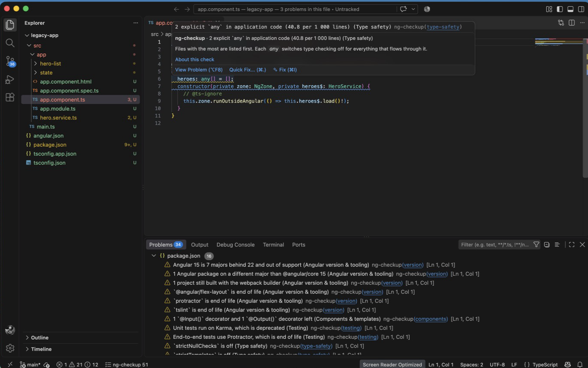

# ng-checkup for VS Code

**[ng-checkup](https://github.com/stefankuburovic/ng-checkup#readme) findings inline, in the editor you already work in.**

ng-checkup grades an Angular codebase on how far it is from current Angular: the version gap, deprecated APIs, third-party packages, zoneless readiness, signals and standalone adoption, state management, testing, type safety, security, circular dependencies and bundle size. This extension runs it on your workspace and puts every finding where the code is.



## What you get

- **Every finding at its file and line**, in the Problems panel and as a squiggle in the editor. The hover explains why it matters and what fixing it takes; the code links to the documentation of its check.
- **The modernization score** (0 to 100) in the status bar. Click it for the full ng-checkup HTML report beside your code, or open the same page in the browser to print or save it as PDF.
- **Up to date after every save.** Only the files that changed are parsed again, in a worker thread, so typing never waits for the analysis.
- **Your configuration.** `ng-checkup.config.json` in the workspace root applies here as it does in CI: `ignore`, `only`, `skip` and `offline`.

Findings about the project as a whole, such as an outdated Angular or an end-of-life package, are attached to `package.json`, the same place GitHub code scanning shows them with ng-checkup's SARIF output.

## Requirements

An Angular CLI or Nx workspace: `angular.json`, `nx.json` or `project.json` in an open folder (or `angular.json` one folder down). ng-checkup reads the files on disk; nothing has to be built or installed first. Installed dependencies make the deprecated-API and compatibility checks more precise.

In a multi-root workspace each Angular folder is analysed on its own; the status bar shows the folder of the active editor.

## Privacy

Offline by default: no request leaves your machine. With `ng-checkup.registryLookup` on, the npm registry is asked for the latest Angular version and for the metadata of installed packages that depend on Angular. Only package names are sent, never source code or file names. There is no telemetry.

## Commands

| Command | What it does |
| --- | --- |
| `ng-checkup: Run` | Analyses every Angular folder now. |
| `ng-checkup: Open report` | The HTML report of the current folder in a panel beside the editor. |
| `ng-checkup: Open report in browser` | The same report in your browser. |

## Settings

| Setting | Default | |
| --- | --- | --- |
| `ng-checkup.registryLookup` | `false` | Ask the npm registry for the latest Angular and package compatibility. |
| `ng-checkup.highSeverity` | `warning` | Show high findings as `warning` or `error`. Medium findings are warnings, low ones information. |
| `ng-checkup.maxExamples` | `1000` | Locations listed per finding. |
| `ng-checkup.runOnSave` | `true` | Analyse again after a save. |
| `ng-checkup.debounceMs` | `1500` | Wait after the last save before analysing. |

## The same report in CI

The extension bundles the [ng-checkup](https://www.npmjs.com/package/ng-checkup) CLI's analysis. To grade every merge request, fail on regressions against a baseline, or post the report as a pull-request comment, run it in CI:

```bash
npx ng-checkup
```

See the [ng-checkup README](https://github.com/stefankuburovic/ng-checkup#readme) for the GitHub Action, the GitLab template and the baseline workflow.

## Need help with the upgrade?

ng-checkup tells you where the work is. If you want help doing it, from an AngularJS hybrid to zoneless and signals, start with a free [Angular Health Check](https://stefankuburovic.github.io/#health-check).

## License

MIT
